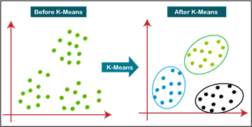
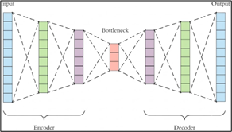

### ĐẠI HỌC QUỐC GIA TP. HỒ CHÍ MINH
### TRƯỜNG ĐẠI HỌC CÔNG NGHỆ THÔNG TIN
### PHÒNG ĐÀO TẠO SAU ĐẠI HỌC & KHOA HỌC CÔNG NGHỆ

 

 
 

### IS6002 - HỆ CƠ SỞ DỮ LIỆU TIÊN TIẾN
### BÁO CÁO GIAI ĐOẠN 1 ĐỒ ÁN CUỐI KỲ VỀ VIỆC TÌM HIỂU BÀI BÁO
### METHODOLOGY INTERACTION BY MACHINE LEARNING MODEL TO DETECT VULNERABILITY IN SMART CONTRACT OF BLOCKCHAIN

 

| | |
|---|---|
| **Mã lớp** | IS6002.26.1.CH.02 |
| **Giảng viên** | PGS.TS. Nguyễn Đình Thuân   ThS. Nguyễn Thị Kim Phụng |
| **Nhóm** | 13 |
| **Thành viên** | Lê Anh Tuấn - 26848245   Lê Thị Thương - 26848218   Nguyễn Vũ Mai Phương - 26848176   Nguyễn Dương Quốc Anh - 26848005 |

 

**Tác giả bài báo:** ThS. Bùi Tổng Nha & PGS.TS. Nguyễn Đình Thuân  
*(Trường Đại học Công nghệ Thông tin, ĐHQG - TPHCM)*

**Hội nghị công bố:** 2022 RIVF International Conference on Computing and Communication Technologies (RIVF)

 

*TP. Hồ Chí Minh, tháng 10 năm 2026*

---

## MỤC LỤC

- [I. NỘI DUNG CHÍNH CỦA BÀI BÁO](#i-nội-dung-chính-của-bài-báo)
  - [1. Kiến thức nền tảng](#1-kiến-thức-nền-tảng)
  - [2. Bối cảnh & Vấn đề nghiên cứu](#2-bối-cảnh--vấn-đề-nghiên-cứu)
  - [3. Phân loại lỗ hổng (Vulnerabilities)](#3-phân-loại-lỗ-hổng-vulnerabilities)
  - [4. Tập dữ liệu nghiên cứu (Datasets)](#4-tập-dữ-liệu-nghiên-cứu-datasets)
  - [5. Phương pháp luận và Mô hình đề xuất (Research Methodology)](#5-phương-pháp-luận-và-mô-hình-đề-xuất-research-methodology)
    - [a. Phương pháp Phân cụm K-Means (K-Means Clustering)](#a-phương-pháp-phân-cụm-k-means-k-means-clustering)
    - [b. Phương pháp Mạng tự mã hóa (Autoencoder)](#b-phương-pháp-mạng-tự-mã-hóa-autoencoder)
  - [6. Các thước đo đánh giá mô hình (Evaluation Metrics)](#6-các-thước-đo-đánh-giá-mô-hình-evaluation-metrics)
  - [7. Kết quả thực nghiệm của nhóm tác giả](#7-kết-quả-thực-nghiệm-của-nhóm-tác-giả)
    - [a. Kết quả thực nghiệm với K-Means Clustering](#a-kết-quả-thực-nghiệm-với-k-means-clustering)
    - [b. Kết quả thực nghiệm với Autoencoder](#b-kết-quả-thực-nghiệm-với-autoencoder)
- [II. PHÂN TÍCH TÍNH SOTA (STATE OF THE ART) CỦA BÀI BÁO](#ii-phân-tích-tính-sota-state-of-the-art-của-bài-báo)
  - [1. Ưu điểm và những bước tiến SOTA](#1-ưu-điểm-và-những-bước-tiến-sota)
  - [2. Khoảng trống nghiên cứu](#2-khoảng-trống-nghiên-cứu)
- [III. PHÁT TRIỂN TỪ BÀI BÁO THEO HƯỚNG (WHAT, HOW, WHY)](#iii-phát-triển-từ-bài-báo-what-how-why)
  - [1. Hướng 1 – Chuẩn hóa biểu diễn đặc trưng của Smart Contract](#1-hướng-1--chuẩn-hóa-biểu-diễn-đặc-trưng-của-smart-contract)
  - [2. Hướng 2 – Chuyển dịch sang mô hình phát hiện bất thường một lớp (One-Class Anomaly Detection)](#2-hướng-2--chuyển-dịch-sang-mô-hình-phát-hiện-bất-thường-một-lớp-one-class-anomaly-detection)
  - [3. Hướng 3 – Xây dựng quy trình lai 2 tầng “Sàng lọc – Xác nhận” (Hybrid Filtering - Verification)](#3-hướng-3--xây-dựng-quy-trình-lai-2-tầng-sàng-lọc--xác-nhận-hybrid-filtering---verification)
- [IV. KẾT LUẬN](#iv-kết-luận)
- [V. TÀI LIỆU THAM KHẢO](#v-nguồn-tham-khảo)

---

## I. NỘI DUNG CHÍNH CỦA BÀI BÁO

### 1. Kiến thức nền tảng

Smart Contract (Hợp đồng thông minh) là những chương trình chứa mã nguồn gồm các điều kiện và quy tắc, sau đó được triển khai trên Blockchain. Trong những năm gần đây, Smart Contract đã trở thành nền tảng cốt lõi để phát triển các ứng dụng phi tập trung (dApps) đáng tin cậy, đặc biệt là trên nền tảng Ethereum.

Ý tưởng cốt lõi của Ethereum là phân tách kiến trúc thành 2 tầng độc lập: tầng chuỗi khối (Blockchain Layer) để lưu trữ, xác thực dữ liệu và tầng hợp đồng (Contract Layer) để thực thi các Smart Contract. Sự tách biệt này giúp hệ thống vận hành linh hoạt hơn đáng kể, đồng thời sử dụng đồng tiền mã hóa Ether (ETH) làm phương tiện cho mọi giao dịch.

Cụ thể trong quá trình vận hành, trước khi triển khai lên mạng lưới Ethereum thì mã nguồn của Smart Contract sẽ được biên dịch thành mã byte (Bytecode). Khi có một giao dịch được khởi tạo và gọi đến Smart Contract, Máy ảo Ethereum (EVM – Ethereum Virtual Machine) sẽ giải mã đoạn bytecode tương ứng thành một chuỗi các mã thao tác (Opcode) để thực thi tuần tự và kiểm tra các điều kiện định sẵn. Nếu thỏa mãn toàn bộ ràng buộc, giao dịch sẽ được hoàn tất; ngược lại, hệ thống sẽ từ chối giao dịch.

### 2. Bối cảnh & Vấn đề nghiên cứu

Sự phát triển mạnh mẽ của hệ sinh thái Ethereum đã kéo theo hàng triệu Smart Contract được triển khai để tự động hóa các giao dịch giá trị lớn. Tuy nhiên, việc đảm bảo an toàn bảo mật cho các Smart Contract này đang đối mặt với những thách thức nghiêm trọng xuất phát từ vấn đề thực tiễn sau:

- **Mục tiêu hấp dẫn về tài chính:** Smart Contract trên mạng lưới Ethereum chủ yếu xử lý trực tiếp các giao dịch tiền tệ và tài sản số.
- **Rủi ro từ mã nguồn và tính bất biến (Immutability):** do được viết bởi lập trình viên nên mã nguồn Smart Contract khó tránh khỏi các lỗ hổng lập trình. Nguy hiểm hơn, một khi đã triển khai lên Blockchain thì Smart Contract sẽ không thể chỉnh sửa hay vá lỗi; kẻ tấn công có thể lợi dụng điểm yếu này để khai thác lỗ hổng và chiếm đoạt tiền mã hóa.
- **Thiếu tiêu chuẩn đánh giá:** hiện vẫn thiếu các thước đo đánh giá (Evaluation Metrics) chuẩn xác để kiểm định chất lượng và mức độ an toàn của một Smart Contract.
- **Hạn chế của các công cụ kiểm tra truyền thống và dữ liệu thực tế:** các công cụ hiện tại chủ yếu phát hiện lỗi bằng cách đối chiếu mã nguồn với một bộ quy tắc định sẵn (Predefined Rules). Cách tiếp cận này không thể nhận diện các loại lỗ hổng mới hay các kỹ thuật lập trình che giấu lỗi tinh vi, dẫn đến tỷ lệ cảnh báo sai (False Positive) và bỏ sót lỗi (False Negative) rất cao. Bên cạnh đó, dữ liệu trên mạng lưới thực tế hầu hết đều chưa được gán nhãn và không có dấu hiệu trực tiếp để phân biệt ngay đâu là tác vụ bất hợp pháp.

Để giải quyết các hạn chế trên, nhóm tác giả đề xuất kết hợp thuật toán K-Means Clustering (thuộc nhóm Unsupervised Machine Learning) và Autoencoder (thuộc nhóm Deep Learning) để thực hiện gom cụm các đối tượng, phát hiện bất thường và phân biệt giữa dữ liệu độc hại với dữ liệu an toàn trước khi triển khai Smart Contract lên mạng lưới Ethereum.

### 3. Phân loại lỗ hổng (Vulnerabilities)

Lỗ hổng Smart Contract được chia thành 4 nhóm chính: vấn đề bảo mật (Security Issues), vấn đề vận hành (Operational Issues), vấn đề chức năng (Functional Issues), vấn đề phát triển (Development Issues). Dựa trên mức độ thiệt hại kinh tế thực tế, bài báo nêu rõ 3 loại lỗ hổng phổ biến nhất:

- **Lỗ hổng số học (Arithmetic Vulnerability):** lỗi tràn số nguyên trên (Integer Overflow) và tràn số nguyên dưới (Integer Underflow). Lỗi này xảy ra khi kết quả của một phép tính vượt quá giới hạn tối đa hoặc nhỏ hơn giới hạn tối thiểu mà kiểu dữ liệu trong Smart Contract có thể lưu trữ, làm sai lệch hoàn toàn số dư tài khoản hoặc giá trị giao dịch.
- **Tấn công tái nhập (Reentrancy):** lỗ hổng cho phép kẻ tấn công gọi đệ quy rút cạn tiền trước khi trạng thái contract được cập nhật.
- **Hợp đồng chứa địa chỉ không xác định (Contract Contains An Unknown Address):** việc cho phép gọi đến các địa chỉ bên ngoài không đáng tin cậy mà thiếu bước kiểm tra an toàn sẽ tạo cơ hội cho kẻ tấn công thực thi mã độc và chiếm quyền kiểm soát.

### 4. Tập dữ liệu nghiên cứu (Datasets)

Để thực nghiệm trên các mô hình, nhóm tác giả thu thập và kết hợp dữ liệu từ các nguồn:

- **Smartbugs Dataset & SolidiFI-benchmark:** chứa các Smart Contract đã được gán nhãn, đánh giá và phân loại sẵn dựa trên từng nhóm lỗ hổng bảo mật cụ thể.
- **Smartbugs Wild:** chứa hàng chục nghìn Smart Contract được thu thập trực tiếp từ môi trường mạng lưới Ethereum thực tế. Vì các Smart Contract trong tập dữ liệu này chưa được gán nhãn, nhóm tác giả sử dụng hai công cụ phân tích tĩnh là Slither và Ethainter để kiểm tra rủi ro bảo mật cũng như tạo cơ sở đối chiếu cho quá trình đánh giá mô hình.

### 5. Phương pháp luận và Mô hình đề xuất (Research Methodology)

#### a. Phương pháp Phân cụm K-Means (K-Means Clustering)

K-Means Clustering là thuật toán học không giám sát dùng để chia dữ liệu thành k cụm dựa trên mức độ tương đồng. Mỗi cụm có một tâm cụm (Centroid) đại diện cho hành vi trung bình của các điểm dữ liệu thuộc cụm đó. Thuật toán sử dụng khoảng cách Euclidean để xác định vị trí của từng đối tượng so với tâm cụm, từ đó gán mỗi điểm dữ liệu vào tâm cụm gần nhất và tính toán lại vị trí tâm cụm. Hai bước này được lặp lại cho đến khi vị trí các tâm cụm ổn định hoặc đạt đến số vòng lặp quy định.

  
   
  <em>Hình 1: Minh họa K-Means Clustering</em>

**Đánh giá phương pháp:** K-Means không trực tiếp chỉ ra Smart Contract thuộc nhóm an toàn hay có lỗ hổng mà chỉ đóng vai trò gom nhóm các mẫu có đặc trưng tương đồng. Sau quá trình phân cụm, các nhóm dữ liệu sẽ cần được kiểm tra và phân tích thêm nhằm đánh giá mức độ hiệu quả của mô hình.

#### b. Phương pháp Mạng tự mã hóa (Autoencoder)

Autoencoder là mô hình mạng nơ-ron học sâu (Deep Learning) được huấn luyện để tái tạo lại dữ liệu đầu vào sao cho dữ liệu đầu ra gần giống với ban đầu nhất có thể. Mô hình được chia thành 2 mạng kết nối với nhau thông qua 4 thành phần chính:

- **Bộ mã hóa (Encoder):** nén dữ liệu đầu vào và giảm số chiều của dữ liệu để mô hình học cách biểu diễn mã hóa.
- **Nút cổ chai (Bottleneck):** tầng ẩn trung tâm chứa biểu diễn dữ liệu ở dạng nén với số chiều nhỏ nhất có thể.
- **Bộ giải mã (Decoder):** học cách khôi phục lại dữ liệu từ biểu diễn đã được nén ở tầng Bottleneck sao cho sát với đầu vào gốc nhất.
- **Hàm mất mát tái tạo (Reconstruction Loss):** đánh giá mức độ hoạt động hiệu quả của Decoder thông qua việc đo lường độ sai lệch giữa dữ liệu đầu vào gốc và dữ liệu được mô hình tái tạo.

  
   
  <em>Hình 2: Minh họa Autoencoder</em>

Ý tưởng cốt lõi của phương pháp này là Autoencoder sẽ học các đặc điểm phổ biến của dữ liệu bình thường. Khi đưa vào một điểm dữ liệu an toàn (có đặc trưng tương đồng với dữ liệu đã học), mô hình có thể tái tạo lại điểm đó với sai số rất thấp. Ngược lại, nếu điểm dữ liệu mang đặc điểm bất thường hoặc độc hại, mô hình sẽ không thể khôi phục chính xác dẫn đến sai số tái tạo cao vượt qua một ngưỡng (Threshold) xác định trước, từ đó giúp phân loại điểm dữ liệu là an toàn hay độc hại.

**Đánh giá phương pháp:** Autoencoder rất phù hợp với bài toán có nghiên cứu khi số lượng dữ liệu độc hại rất ít và phần lớn dữ liệu chưa có nhãn rõ ràng. Tuy nhiên tương tự như K-Means Clustering, phương pháp này chỉ cho biết mức độ bất thường của một mẫu thông qua sai số tái tạo chứ không trực tiếp chỉ ra vị trí dòng mã lỗi hay định danh loại lỗ hổng cụ thể tồn tại trong Smart Contract.

### 6. Các thước đo đánh giá mô hình (Evaluation Metrics)

Do tập dữ liệu thực tế có sự mất cân bằng nghiêm trọng giữa số lượng mẫu an toàn và mẫu độc hại, việc sử dụng độ chính xác thông thường (Accuracy) sẽ không phản ánh đúng hiệu năng của mô hình và dễ dẫn đến kết quả sai lệch. Vì vậy, nhóm tác giả sử dụng các thước đo trung bình vĩ mô (Macro Average Metrics) và độ chính xác cân bằng (Balanced Accuracy) làm tiêu chuẩn đánh giá chính:

- **Độ chính xác thông thường (Accuracy):**
  $$Accuracy = \frac{TP + TN}{TP + FP + FN + TN}$$

- **Độ chính xác cân bằng (Balanced Accuracy):**
  $$Balanced\ Accuracy = \frac{1}{c} \sum_{j=1}^{c} R_j$$

- **Độ chuẩn xác vĩ mô (Macro Precision):**
  $$Macro\ Precision = \frac{1}{c} \sum_{j=1}^{c} \frac{TP_j}{TP_j + FP_j}$$

- **Độ nhạy vĩ mô (Macro Recall):**
  $$Macro\ Recall = \frac{1}{c} \sum_{j=1}^{c} \frac{TP_j}{TP_j + FN_j}$$

- **Điểm F1 vĩ mô (Macro F1-Score):**
  $$Macro\ F1 = \frac{1}{c} \sum_{j=1}^{c} \frac{2 \times P_j \times R_j}{P_j + R_j}$$

### 7. Kết quả thực nghiệm của nhóm tác giả

#### a. Kết quả thực nghiệm với K-Means Clustering

**Cấu hình và chọn số cụm k:** Mô hình được thử nghiệm với nhiều giá trị k khác nhau (10.000 lần khởi tạo ngẫu nhiên, 150.000 vòng lặp và 256 batches). Dựa trên Độ quán tính (Inertia) qua phương pháp Khuỷu tay (Elbow), k = 5 được chọn là số cụm tối ưu nhất.

**Phân bố cụm và gán nhãn:**
- Dữ liệu độc hại (Harmful) tập trung chủ yếu ở Cụm 2 và 4 (chiếm hơn 83% dữ liệu độc hại ở tập Train và gần 82% ở tập Test).
- Cụm 1, 3 và 5 chứa gần 85% toàn bộ dữ liệu an toàn (Non-harmful).
- Nhóm tác giả trực quan hóa các cụm trên không gian 2D/3D bằng thuật toán giảm chiều PCA, sau đó gộp Cụm 2, 4 thành nhãn Harmful và gộp Cụm 1, 3, 5 thành nhãn Non-Harmful để lập Ma trận nhầm lẫn (Confusion Matrix).

**Hiệu năng phân loại:**
- Mô hình đạt độ chính xác cân bằng (Balanced Accuracy) và Macro Recall cao ở mức 82,23% (tập Train) và 81,58% (tập Test).
- Trên tập kiểm thử, K-Means phát hiện đúng 73% dữ liệu độc hại và 85% dữ liệu an toàn, với tỷ lệ cảnh báo sai (False Positives) chỉ 13%.

#### b. Kết quả thực nghiệm với Autoencoder

**Cấu hình và ngưỡng phát hiện (Threshold):** Mô hình được huấn luyện qua 20 epochs với 2048 batches, sử dụng hàm mất mát sai số bình phương logarit. Các tầng ẩn dùng hàm kích hoạt tanh trong khoảng [-1, 1] và tầng đầu ra chuẩn hóa trong khoảng [0, 1] để biểu thị xác suất độc hại. Dựa trên sự đánh đổi giữa Precision và Recall, ngưỡng sai số tái tạo được chọn ở mức xấp xỉ dưới 4 nhằm bắt được phần lớn dữ liệu độc hại mà không phân loại nhầm dữ liệu an toàn.

**Hiệu năng phân loại:**
- Autoencoder đạt Balanced Accuracy và Macro Recall là 71,27% (tập Train) và 74,46% (tập Test). Đặc biệt, chỉ số ROC AUC trên tập kiểm thử đạt mức rất tốt là 83,93%.
- Xét trên ma trận nhầm lẫn, mô hình nhận diện chính xác tới 96% dữ liệu an toàn, đồng thời phát hiện đúng 45% điểm độc hại trên tập huấn luyện và 54% trên tập kiểm thử.

---

## II. PHÂN TÍCH TÍNH SOTA (STATE OF THE ART) CỦA BÀI BÁO

### 1. Ưu điểm và những bước tiến SOTA

Khi đối sánh trực tiếp với các công trình phát hiện bất thường không giám sát tiền thân trên mạng lưới Blockchain mà bài báo kế thừa, nghiên cứu của nhóm tác giả đã tạo ra bước tiến rõ rệt trên 5 phương diện cốt lõi: miền bài toán, quy mô dữ liệu & nguồn nhãn, mô hình thuật toán, giao thức đánh giá và hiệu quả phát hiện.

1. **Mở rộng miền bài toán và khắc phục hạn chế của công cụ dựa trên luật:** Các nghiên cứu trước đó ([1] & [2] & [3]) chỉ dừng lại ở mạng lưới giao dịch tài chính Bitcoin. Bài báo đã chuyển dịch hướng tiếp cận sang lỗ hổng Smart Contract trên Ethereum. Đồng thời, bằng cách học trực tiếp từ phân phối dữ liệu thay vì đối chiếu bộ luật cứng nhắc (Predefined Rules) như các công cụ phân tích tĩnh (Slither, Mythril), phương pháp này có tiềm năng nhận diện các hành vi bất thường mới và giảm thiểu cảnh báo giả.

2. **Đột phá về quy mô thực nghiệm và giải quyết bài toán khan hiếm nhãn:** Bài báo nâng quy mô dữ liệu lên ~15 triệu điểm (lớn hơn từ 15 đến 150 lần so với các nghiên cứu tiền thân) và xử lý hiệu quả nhờ cơ chế phân cụm theo lô nhỏ (Mini-Batch 256 điểm). Đặc biệt, để khắc phục điểm yếu chỉ có khoảng 30 mẫu gian lận thực tế của các nghiên cứu trước, tác giả đã kết hợp dữ liệu đã gán nhãn (SmartBugs, SolidiFI-benchmark) với dữ liệu thực tế (SmartBugs Wild) được quét rủi ro tự động qua Slither và Ethainter. Cách làm này đóng vai trò như một cơ chế giám sát yếu (Weak Supervision), tạo ra bộ nhãn tham chiếu đủ lớn để kiểm chứng định lượng.

3. **Bổ sung mô hình Học sâu (Deep Learning) và tối ưu hóa độ ổn định của K-Means:** Thay vì chỉ dùng các mô hình học máy nông (Shallow ML) với khoảng cách tuyến tính như trước, bài báo tích hợp thêm Autoencoder (đạt ROC-AUC 0,839 trên tập Test), giúp nắm bắt các mối quan hệ phi tuyến tính giữa các đặc trưng thông qua sai số tái tạo. Ở nhánh K-Means, việc tăng số lần khởi tạo tâm cụm ngẫu nhiên lên tới 10.000 lần (so với chỉ 5 lần của Monaco et al. [3]) giúp thuật toán tránh bị rơi vào cực trị cục bộ và tăng độ tin cậy của kết quả phân cụm.

4. **Cải thiện vượt bậc hiệu quả phát hiện:** Với k = 5, mô hình K-Means đã gom được 64/77 điểm độc hại (83,1%) trên tập huấn luyện và 18/22 điểm độc hại (81,8%) trên tập kiểm thử vào hai cụm trọng tâm (Cụm 2 và Cụm 4). So với tỷ lệ phát hiện chỉ đạt 10,0% (Pham & Lee [1]) và 16,7% (Monamo et al. [3]), hiệu năng bắt mẫu độc hại của bài báo cao hơn từ 5 đến 8 lần.

5. **Chuẩn hóa giao thức đánh giá và tăng khả năng diễn giải trực quan:** Khác với các nghiên cứu tiền thân chỉ đếm số vụ gian lận tìm được trên toàn bộ tập dữ liệu, bài báo phân tách rõ tập Huấn luyện – Kiểm thử (80/20), thiết lập Ma trận nhầm lẫn và áp dụng bộ thước đo chuyên biệt cho dữ liệu lệch (Balanced Accuracy, Macro Precision/Recall/F1, ROC-AUC). Sự tương đồng kết quả giữa tập Train và Test (Balanced Accuracy đạt 0,822 và 0,816) chứng minh khả năng tổng quát hóa tốt. Ngoài ra, việc dùng PCA chiếu dữ liệu xuống không gian 2D/3D giúp trực quan hóa rõ ràng tâm cụm và vùng tập trung mã độc (Cụm 2 và 4).

### 2. Khoảng trống nghiên cứu

Mặc dù có những cải thiện rõ rệt về mặt thực nghiệm so với các bài báo tiền thân, khi phân tích sâu về mặt học thuật và tính chặt chẽ thì vẫn có những hạn chế nhất định sau:

- **Mất thông tin ngữ nghĩa về loại lỗ hổng và vị trí lỗi:** cả hai mô hình chỉ dừng lại ở bài toán phân loại nhị phân (Độc hại / An toàn) chứ không thể phân biệt cụ thể Smart Contract đang trực tiếp mắc loại lỗ hổng nào đồng thời không chỉ ra được dòng mã nguồn (Line of Code) gây ra lỗ hổng để hỗ trợ lập trình viên khắc phục.
- **Quy trình thực nghiệm chưa hoàn toàn "Không giám sát" (Not Truly Unsupervised):** mặc dù định vị là phương pháp học không giám sát, nhóm tác giả vẫn phải dựa vào nhãn có sẵn (Ground Truth) ở bước hậu xử lý để biết Cụm 2 và Cụm 4 chứa nhiều điểm độc hại rồi mới gộp chúng lại để tính điểm phân loại.
- **Tính mới về mặt thuật toán còn hạn chế chi tiết kỹ thuật:** quy trình trích xuất đặc trưng từ mã nguồn/bytecode của Smart Contract thành các vector số học đầu vào lại không được mô tả chi tiết, gây khó khăn cho việc tái lập thực nghiệm (Reproducibility).

---

## III. PHÁT TRIỂN TỪ BÀI BÁO THEO HƯỚNG (WHAT, HOW, WHY)

Từ những khoảng trống về mặt phương pháp luận nhóm đã nêu ở phần II và đặt trong bối cảnh các nghiên cứu SOTA hiện nay, chúng em hướng tới các phương pháp phát triển mới. Mỗi hướng được giải quyết qua ba câu hỏi: Làm gì (What), Làm thế nào (How) và Vì sao (Why).

### 1. Hướng 1 – Chuẩn hóa biểu diễn đặc trưng của Smart Contract

**What:** Chuẩn hóa đơn vị dữ liệu đầu vào ở cấp độ từng hợp đồng thông minh (Smart Contract) hoặc từng hàm thực thi, đồng thời biểu diễn chúng thành các vector đặc trưng giàu ngữ nghĩa cấu trúc thay cho các đặc trưng thống kê rời rạc.

**How:** Xây dựng quy trình trích xuất chuỗi mã thao tác (Opcode Sequence) trực tiếp từ EVM Bytecode, hoặc ứng dụng các mô hình ngôn ngữ mã nguồn tiền huấn luyện (như CodeBERT) để nhúng (embedding) mã nguồn Solidity thành các vector biểu diễn ngữ nghĩa.

**Why:** Trong khuôn khổ bài báo gốc, việc trích xuất đặc trưng chủ yếu dựa trên biểu đồ tần suất (histogram) kết hợp dữ liệu tổng hợp; đồng thời ở phần kết luận, nhóm tác giả cũng đã gợi mở rằng việc đầu tư sâu hơn vào kỹ thuật đặc trưng (feature engineering) sẽ mở ra nhiều giải pháp tiềm năng giúp nâng cao chất lượng mô hình trong tương lai.

### 2. Hướng 2 – Chuyển dịch sang mô hình phát hiện bất thường một lớp (One-Class Anomaly Detection)

**What:** sử dụng các mô hình học máy/học sâu được thiết kế chuyên biệt cho bài toán phát hiện bất thường một lớp (One-Class Classification).

**How:** triển khai và đối sánh các mô hình Isolation Forest, Deep SVDD và Mạng tự mã hóa biến phân một lớp (One-Class VAE) (hoặc kết hợp nén đặc trưng qua tầng Bottleneck trước khi cô lập điểm dị biệt). Thay vì gán nhãn cụm cứng (Hard Clustering), hệ thống sẽ xuất ra điểm số bất thường liên tục (Continuous Anomaly Score) để xếp hạng mức độ rủi ro của từng hợp đồng.

**Why:** thuật toán K-Means trong bài báo giả định các cụm có dạng hình cầu, kích thước tương đương và bắt buộc phải dùng nhãn thực tế (Ground Truth) ở bước hậu xử lý để biết Cụm 2 và Cụm 4 là độc hại. Ngược lại, các mô hình một lớp chỉ cần học trên tập dữ liệu an toàn (Normal data) để định hình biên giới chuẩn, hoàn toàn phù hợp với thực tế dữ liệu nhãn độc hại cực kỳ khan hiếm trên Blockchain.

### 3. Hướng 3 – Xây dựng quy trình lai 2 tầng “Sàng lọc – Xác nhận” (Hybrid Filtering - Verification)

**What:** Thiết kế kiến trúc kiểm toán hai tầng: sử dụng mô hình học không giám sát (từ Hướng 2) làm tầng sàng lọc sơ bộ (Tầng 1), kết hợp các công cụ phân tích chuyên sâu sẵn có trong nghiên cứu gốc là Slither và Ethainter làm tầng xác nhận lỗi (Tầng 2).

**How:**
- **Tầng 1 (Sàng lọc tốc độ cao):** Chấm điểm bất thường toàn bộ kho dữ liệu hàng triệu Smart Contract và trích xuất danh sách Top-K hợp đồng có rủi ro cao nhất.
- **Tầng 2 (Xác nhận và định vị lỗi):** Chạy công cụ Slither và Ethainter chỉ riêng trên danh sách Top-K. Hệ thống chỉ phát cảnh báo khi cả hai tầng đồng thuận, đồng thời trích xuất rõ tên lỗ hổng (Reentrancy, Arithmetic...) kèm vị trí dòng mã cần khắc phục.

**Why:** bài báo đã giải quyết rất tốt mục tiêu ưu tiên độ phủ (Recall) trên tập dữ liệu siêu mất cân bằng để tránh bỏ lọt tấn công, giúp gom phần lớn mẫu lỗi vào Cụm 2 và Cụm 4. Tuy nhiên, do lượng hợp đồng an toàn ngoài thực tế quá lớn (hơn 559.000 điểm nằm chung trong hai cụm này trên tập kiểm thử), việc bổ sung thêm một bước lọc tự động là bước nối tiếp tự nhiên để hỗ trợ kiểm toán viên. Tái sử dụng chính bộ công cụ Slither/Ethainter của bài báo vào Tầng 2 trên tập Top-K vừa giúp thu hẹp đáng kể cảnh báo giả (False Positives), vừa tiết kiệm thời gian tính toán và cung cấp vị trí lỗi chi tiết trong mã nguồn.

---

## IV. KẾT LUẬN

Bài báo đã nghiên cứu khả năng ứng dụng các phương pháp học máy không giám sát, cụ thể là K-means và Autoencoder, trong việc phát hiện bất thường liên quan đến lỗ hổng bảo mật của hợp đồng thông minh trên nền tảng blockchain.

Thông qua quá trình xây dựng và đánh giá mô hình, nghiên cứu của nhóm tác giả cho thấy học máy có tiềm năng hỗ trợ phân tích dữ liệu hợp đồng thông minh, nhận diện các mẫu bất thường và góp phần nâng cao hiệu quả của quá trình kiểm tra bảo mật.

Bên cạnh những kết quả đạt được, nghiên cứu cũng mở ra nhiều hướng phát triển nhằm cải thiện khả năng phát hiện của mô hình, đặc biệt là trong việc lựa chọn đặc trưng dữ liệu, nâng cao chất lượng tập dữ liệu và kết hợp các phương pháp phân tích phù hợp. Nhìn chung, bài báo cung cấp một cơ sở tham khảo có giá trị cho việc ứng dụng học máy vào lĩnh vực bảo mật blockchain, đồng thời tạo tiền đề cho các nghiên cứu tiếp theo hướng đến xây dựng những giải pháp phát hiện lỗ hổng hợp đồng thông minh hiệu quả và đáng tin cậy hơn.

---

## V. TÀI LIỆU THAM KHẢO

[1] T. Pham and S. Lee. (2016). “Anomaly detection in Bitcoin network using unsupervised learning methods.”

[2] M. Bartoletti, B. Pes, and S. Serusi. (2018). “Data mining for detecting Bitcoin Ponzi schemes.”

[3] Patrick Monamo, Vukosi Marivate, Bheki Twala (2017). “Unsupervised learning for robust Bitcoin fraud detection.”

[4] Ethereum.org (2025), “What Is Ethereum?”

[5] Amazon Web Services (AWS) (n.d), “What is Blockchain Technology?”

[6] IBM (n.d), “What Are Smart Contracts on Blockchain?”

[7] Ethereum.org (n.d), “Introduction to Smart Contracts.”

[8] Solidity (n.d), “Solidity Documentation.”

[9] Ethereum.org (n.d), “Introduction to Ethereum.”

[10] SmartBugs (n.d.), “SmartBugs Curated: A Curated Dataset of Vulnerable Solidity Smart Contracts,” GitHub.

[11] SmartBugs (n.d.), “SmartBugs Wild Dataset,” GitHub.

[12] SmartBugs (n.d.), “SolidiFI-Benchmark: A Benchmark for Solidity Smart Contract Vulnerabilities,” GitHub.

---
