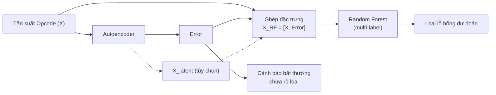

**ĐẠI HỌC QUỐC GIA TP. HỒ CHÍ MINH** 
**TRƯỜNG ĐẠI HỌC CÔNG NGHỆ THÔNG TIN** 
**PHÒNG ĐÀO TẠO SAU ĐẠI HỌC & KHOA HỌC CÔNG NGHỆ**

# IS6002 – HỆ CƠ SỞ DỮ LIỆU TIÊN TIẾN

### ĐỒ ÁN CUỐI KỲ: TÌM HIỂU BÀI BÁO KHOA HỌC

***“Methodology Interaction by Machine Learning Model to Detect Vulnerability in Smart Contract of Blockchain”***

<table>
  <tr>
    <td><b>Mã lớp</b></td>
    <td>IS6002.26.1.CH.02</td>
  </tr>
  <tr>
    <td><b>Giảng viên</b></td>
    <td>PGS.TS. Nguyễn Đình Thuân ThS. Nguyễn Thị Kim Phụng</td>
  </tr>
  <tr>
    <td><b>Nhóm 13</b></td>
    <td>Lê Anh Tuấn – 26848245 Lê Thị Thương – 26848218 Nguyễn Vũ Mai Phương – 26848176 Nguyễn Dương Quốc Anh – 26848005</td>
  </tr>
</table>

<b>Tác giả bài báo:</b> ThS. Bùi Tổng Nha & PGS.TS. Nguyễn Đình Thuân 
(Trường Đại học Công nghệ Thông tin, ĐHQG – TP.HCM) 
<b>Hội nghị công bố:</b> 2022 RIVF International Conference on Computing and Communication Technologies (RIVF)

<i>TP. Hồ Chí Minh, tháng 11 năm 2026</i>

---

## Mục lục

- [Bảng nhiệm vụ](#bảng-nhiệm-vụ)
- [1. Nội dung chính bài báo](#1-nội-dung-chính-bài-báo)
  - [1.1. Vấn đề và mục tiêu nghiên cứu](#11-vấn-đề-và-mục-tiêu-nghiên-cứu)
  - [1.2. Tập dữ liệu nghiên cứu](#12-tập-dữ-liệu-nghiên-cứu)
  - [1.3. Phương pháp nghiên cứu](#13-phương-pháp-nghiên-cứu)
  - [1.4. Thước đo đánh giá và kết quả thực nghiệm](#14-thước-đo-đánh-giá-và-kết-quả-thực-nghiệm)
- [2. Phân tích tính SOTA (State of the Art) của bài báo](#2-phân-tích-tính-sota-state-of-the-art-của-bài-báo)
  - [2.1. Những bước tiến của nghiên cứu](#21-những-bước-tiến-của-nghiên-cứu)
  - [2.2. Khoảng trống nghiên cứu](#22-khoảng-trống-nghiên-cứu)
- [3. Phát triển từ bài báo (What, How, Why)](#3-phát-triển-từ-bài-báo-what-how-why)
  - [3.1. WHAT – Làm gì?](#31-what--làm-gì)
  - [3.2. HOW – Làm như thế nào?](#32-how--làm-như-thế-nào)
  - [3.3. WHY – Vì sao chọn hướng này?](#33-why--vì-sao-chọn-hướng-này)
- [4. Kết luận](#4-kết-luận)
- [5. Tài liệu tham khảo](#5-tài-liệu-tham-khảo)

---

## Bảng nhiệm vụ

<table>
  <thead>
    <tr>
      <th>Thành viên</th>
      <th>Nhiệm vụ</th>
      <th>Quá trình thực hiện</th>
      <th>Mức độ hoàn thành</th>
    </tr>
  </thead>
  <tbody>
    <tr>
      <td>Lê Thị Thương</td>
      <td rowspan="2">Phần 1 + Phần 2</td>
      <td rowspan="4">Giai đoạn đầu tiên, nhóm dành ra các ngày để cùng đọc hiểu và bổ sung kiến thức cho nhau về nội dung trong bài báo. Các thành viên chọn phần thực hiện. Sau khi hoàn tất bản thảo, nhóm họp để nhận xét chéo và tổng hợp thành bản báo cáo cuối cùng.</td>
      <td align="center">100%</td>
    </tr>
    <tr>
      <td>Nguyễn Vũ Mai Phương</td>
      <td align="center">100%</td>
    </tr>
    <tr>
      <td>Lê Anh Tuấn</td>
      <td rowspan="2">Phần 3 + Mã nguồn minh họa</td>
      <td align="center">100%</td>
    </tr>
    <tr>
      <td>Nguyễn Dương Quốc Anh</td>
      <td align="center">100%</td>
    </tr>
  </tbody>
</table>

---

## 1. Nội dung chính bài báo

### 1.1. Vấn đề và mục tiêu nghiên cứu

Smart Contract (hợp đồng thông minh) trên nền tảng Ethereum chủ yếu xử lý giao dịch tài chính, khó thay đổi sau khi triển khai và thiếu cơ chế đánh giá chất lượng. Những đặc điểm này khiến Smart Contract trở thành mục tiêu hấp dẫn của các cuộc tấn công khai thác lỗ hổng bảo mật. Các lỗ hổng được chia thành bốn nhóm: bảo mật, vận hành, chức năng và quá trình phát triển.

Các công cụ phát hiện lỗ hổng hiện nay chủ yếu so khớp mã nguồn với một tập luật định sẵn, vì thế khi xuất hiện loại lỗ hổng mới hoặc kỹ thuật lập trình che giấu lỗi thì các công cụ này dễ phát sinh cảnh báo sai (False Positive) và bỏ sót lỗi (False Negative).

Trước hạn chế này, các tác giả đã nghiên cứu khả năng ứng dụng học máy không giám sát (Unsupervised Machine Learning) để phân biệt dữ liệu độc hại (Harmful) và dữ liệu bình thường (Non-harmful). Ý tưởng cốt lõi của bài báo là tiếp cận bài toán theo hướng **phát hiện bất thường (Anomaly Detection)**: dữ liệu độc hại vừa hiếm vừa có đặc điểm khác biệt so với phần lớn dữ liệu nên có thể được nhận diện mà không cần mô tả trước từng dạng lỗi.

### 1.2. Tập dữ liệu nghiên cứu

Bài báo sử dụng ba nguồn dữ liệu:

- **SmartBugs & SolidiFI-benchmark:** các Smart Contract đã được phân loại theo lỗ hổng.
- **SmartBugs-wild:** các Smart Contract chưa có nhãn được thu thập từ mạng Ethereum thực tế; các tác giả sử dụng công cụ Slither và Ethainter để phân tích và gán nhãn rủi ro bảo mật.

### 1.3. Phương pháp nghiên cứu

#### a. Phương pháp phân cụm K-Means (K-Means Clustering)

K-Means là thuật toán học không giám sát, dùng để chia dữ liệu thành ***k*** cụm dựa trên mức độ tương đồng. Thuật toán thực hiện lặp lại hai bước: gán mỗi mẫu vào tâm cụm (Centroid) gần nhất theo khoảng cách Euclidean và cập nhật tâm cụm bằng giá trị trung bình của các mẫu trong cụm. Quá trình kết thúc khi tâm cụm ổn định hoặc đạt số vòng lặp quy định.

> **Đánh giá phương pháp:** K-Means chỉ thực hiện gom nhóm các mẫu có đặc trưng tương đồng, không trực tiếp xác định cụm nào là độc hại. Tác giả sử dụng nhãn dữ liệu để xác định cụm 2 và 4 là độc hại, cụm 1, 3 và 5 là bình thường, sau đó đánh giá bằng ma trận nhầm lẫn (Confusion Matrix).

#### b. Phương pháp mạng tự mã hóa (Autoencoder)

Autoencoder là mô hình mạng nơ-ron học sâu, được huấn luyện để tái tạo dữ liệu đầu vào với sai số thấp nhất. Mô hình gồm bốn thành phần chính:

- **Encoder:** nén và giảm chiều dữ liệu.
- **Bottleneck:** lưu trữ biểu diễn dữ liệu dạng nén.
- **Decoder:** khôi phục dữ liệu từ biểu diễn nén.
- **Reconstruction Loss:** đo độ sai lệch giữa dữ liệu đầu vào và đầu ra tái tạo.

Ý tưởng cốt lõi là mô hình học các đặc trưng phổ biến của dữ liệu bình thường. Vì vậy, mẫu bình thường thường có sai số tái tạo thấp, trong khi mẫu bất thường có sai số cao và được gắn cờ độc hại khi vượt ngưỡng (Threshold). Trong nghiên cứu, mô hình được huấn luyện 20 epoch, sử dụng batch size 2048 và ngưỡng được lựa chọn dựa trên sự đánh đổi giữa Precision và Recall.

> **Đánh giá phương pháp:** Autoencoder phù hợp với dữ liệu mất cân bằng và thiếu nhãn độc hại vì có thể phát hiện các mẫu bất thường thông qua sai số tái tạo. Tuy nhiên, tương tự K-Means, phương pháp này không trực tiếp xác định vị trí dòng mã lỗi hoặc loại lỗ hổng cụ thể trong Smart Contract.

### 1.4. Thước đo đánh giá và kết quả thực nghiệm

Do dữ liệu mất cân bằng nghiêm trọng, Accuracy không phản ánh đúng hiệu năng mô hình. Vì vậy, tác giả sử dụng các thước đo:

- **Balanced Accuracy:** trung bình Recall của các lớp.
- **Macro Precision, Macro Recall, Macro F1:** đánh giá độ chính xác, khả năng phát hiện và sự cân bằng giữa hai chỉ số.
- **ROC AUC:** đánh giá khả năng phân biệt hai lớp ở nhiều ngưỡng khác nhau (chỉ áp dụng cho Autoencoder).

**Kết quả trên tập kiểm thử:**

| Chỉ số | K-Means | Autoencoder |
|---|:---:|:---:|
| Balanced Accuracy | 81,58% | 74,46% |
| Macro Precision | 0,5000 | 0,5000 |
| Macro F1 | 0,4486 | 0,4874 |
| ROC AUC | – | 83,93% |
| Phát hiện mẫu độc hại | 81,8% | 54% |
| Nhận diện mẫu bình thường | ≈ 81% | ≈ 96% |

---

## 2. Phân tích tính SOTA (State of the Art) của bài báo

### 2.1. Những bước tiến của nghiên cứu

Khi đối sánh trực tiếp với các công trình phát hiện bất thường không giám sát tiền thân trên mạng lưới Blockchain mà bài báo kế thừa, nghiên cứu của nhóm tác giả đã tạo ra bước tiến rõ rệt trên 4 phương diện:

1. **Mở rộng miền nghiên cứu:** áp dụng phát hiện bất thường không giám sát vào Smart Contract trên Ethereum, thay vì chỉ tập trung vào giao dịch Bitcoin như một số nghiên cứu trước.
2. **Mở rộng quy mô dữ liệu:** kết hợp SmartBugs, SolidiFI và SmartBugs-wild để xây dựng tập dữ liệu quy mô lớn.
3. **Kết hợp và đánh giá hai thuật toán:** sử dụng K-Means và Autoencoder để phát hiện mẫu độc hại. Trên tập kiểm thử, K-Means phát hiện 81,8% mẫu độc hại và Autoencoder đạt ROC AUC 0,8393.
4. **Cải thiện quy trình đánh giá:** sử dụng Balanced Accuracy, Macro Precision, Macro Recall, Macro F1 và ROC AUC; đồng thời trực quan hóa kết quả bằng PCA.

### 2.2. Khoảng trống nghiên cứu

Mặc dù đạt được một số kết quả thực nghiệm đáng chú ý, công trình vẫn còn những hạn chế và khoảng trống nghiên cứu sau:

- **Hạn chế về thông tin đầu ra:** các mô hình chỉ cung cấp kết quả ở mức phát hiện hoặc nhận diện Smart Contract có dấu hiệu bất thường, chưa xác định cụ thể loại lỗ hổng và vị trí dòng mã nguồn gây ra vấn đề.
- **Chưa hoàn toàn không giám sát:** K-Means cần sử dụng nhãn tham chiếu ở bước hậu xử lý để xác định cụm 2 và 4 là cụm độc hại. Vì vậy, việc phân loại cuối cùng vẫn phụ thuộc vào thông tin nhãn có sẵn.
- **Hạn chế về mức độ mô tả thực nghiệm:** một số thông tin về quá trình trích xuất đặc trưng, biểu diễn dữ liệu chưa được trình bày chi tiết, ảnh hưởng đến khả năng tham khảo và tái lập thực nghiệm.
- **Hạn chế về độ tin cậy của kết quả:** một phần nhãn tham chiếu được tạo từ Slither và Ethainter nên có thể kế thừa sai sót của các công cụ phân tích tĩnh.

---

## 3. Phát triển từ bài báo (What, How, Why)

Bài báo chỉ xác định hợp đồng có bất thường hay không, chưa chỉ ra loại lỗ hổng cụ thể. Vì vậy, nhóm đề xuất kết hợp **Autoencoder** và **Random Forest** nhằm mở rộng kết quả từ phát hiện bất thường sang dự đoán các loại lỗ hổng.

**Mô hình đề xuất:**

| Thành phần | Chức năng |
|---|---|
| Đầu vào | Tần suất xuất hiện của các Opcode trong từng hợp đồng (X). |
| Autoencoder | Học dữ liệu và tạo sai số tái tạo (Error), biểu diễn nén (Xlatent). |
| Ghép đặc trưng | XRF = [X, Error], có thể bổ sung Xlatent. |
| Random Forest | Dự đoán các loại lỗ hổng có thể xuất hiện. |
| Kết quả | Danh sách lỗi dự đoán và cảnh báo Smart Contract bất thường chưa rõ loại. |

### 3.1. WHAT – Làm gì?

Xây dựng mô hình kết hợp hai thuật toán:

- **Autoencoder:** tạo Error để đánh giá mức độ bất thường và Xlatent để biểu diễn đặc điểm Opcode của Smart Contract.
- **Random Forest:** sử dụng đặc trưng Opcode kết hợp thông tin từ Autoencoder để dự đoán nhiều loại lỗ hổng trên cùng một hợp đồng.
- **Error có hai vai trò:** bổ sung thông tin cho Random Forest và cảnh báo độc lập những hợp đồng bất thường nhưng chưa xác định được loại lỗi.

### 3.2. HOW – Làm như thế nào?

**Bước 1 – Chuẩn bị dữ liệu**

- Sử dụng tần suất Opcode của từng Smart Contract, chuyển thành tỷ lệ để so sánh các hợp đồng dài ngắn khác nhau và loại bỏ dữ liệu trùng lặp.
- Sử dụng SmartBugs-wild để huấn luyện Autoencoder; SmartBugs Curated và SolidiFI để huấn luyện, kiểm thử Random Forest.

**Bước 2 – Huấn luyện Autoencoder**

- Huấn luyện trên dữ liệu chưa có nhãn, sau đó dùng mô hình đã huấn luyện để tính Error và Xlatent cho các Smart Contract có nhãn.

**Bước 3 – Huấn luyện Random Forest**

- Đưa XRF = [X, Error] vào mô hình, có thể bổ sung Xlatent. Mỗi loại lỗ hổng được dự đoán theo dạng có/không.
- Bổ sung Smart Contract sạch để mô hình nhận diện cả hợp đồng không có lỗi. Chia dữ liệu huấn luyện và kiểm thử theo hợp đồng, mỗi cấu hình chạy 5 lần.

**Bước 4 – Kết hợp và lưu kết quả**

- Kết hợp kết quả Random Forest và Error theo quy tắc ở bảng dưới. Ngưỡng Error có thể chọn theo 1% hợp đồng có sai số cao nhất. Sắp xếp cảnh báo theo xác suất dự đoán để kiểm toán viên ưu tiên kiểm tra.

  | Random Forest dự đoán | Error của Autoencoder | Kết luận |
  |---|---|---|
  | Có lỗi loại X | Cao hoặc thấp | Cảnh báo lỗi loại X |
  | Không có lỗi | Cao (vượt ngưỡng) | Cảnh báo bất thường chưa rõ loại |
  | Không có lỗi | Thấp | Bình thường |

- Lưu đặc trưng, sai số và kết quả dự đoán vào cơ sở dữ liệu để truy vấn và đánh giá.

### 3.3. WHY – Vì sao chọn hướng này?

- **Xác định loại lỗ hổng:** mở rộng kết quả từ phát hiện bất thường sang dự đoán các loại lỗ hổng cụ thể.
- **Tận dụng dữ liệu chưa có nhãn:** Autoencoder học từ số lượng lớn hợp đồng thực tế, bổ sung thông tin cho Random Forest khi dữ liệu có nhãn còn hạn chế.
- **Cảnh báo lỗi chưa biết:** Random Forest chỉ dự đoán các loại lỗi đã được học, trong khi Error có thể cảnh báo hợp đồng có đặc điểm bất thường nhưng chưa xác định được loại lỗi.
- **Hạn chế bỏ sót:** Autoencoder không loại bỏ hợp đồng. Random Forest vẫn kiểm tra toàn bộ hợp đồng, tránh bỏ qua những mẫu có lỗi nhưng sai số thấp. Điều này đáng chú ý vì bài báo chỉ phát hiện khoảng 54% mẫu độc hại trong tập kiểm thử.
- **Dễ triển khai:** Random Forest có sẵn trong Scikit-learn, không cần GPU và có thể đánh giá mức độ ảnh hưởng của từng đặc trưng.

---

## 4. Kết luận

Bài báo đã trình bày cách ứng dụng các phương pháp học không giám sát trong việc phát hiện Smart Contract có dấu hiệu bất thường về bảo mật. Qua đó, nghiên cứu cho thấy tiềm năng của việc khai thác dữ liệu chưa có nhãn để hỗ trợ quá trình phân tích và đánh giá an toàn hợp đồng thông minh. Đây là hướng tiếp cận có ý nghĩa trong bối cảnh số lượng Smart Contract ngày càng tăng và việc kiểm tra thủ công đòi hỏi nhiều thời gian, công sức.

---

## 5. Tài liệu tham khảo

[1]. B. T. Nha and N. D. Thuan, “Methodology Interaction by Machine Learning Model to Detect Vulnerability in Smart Contract of Blockchain,” in *Proc. 2022 RIVF International Conference on Computing and Communication Technologies*, 2022.
[2]. Amazon Web Services (AWS), “What is Blockchain Technology?,” n.d. [Online].
[3]. IBM, “What Are Smart Contracts on Blockchain?,” n.d. [Online].
[4]. Ethereum.org, “Introduction to Smart Contracts,” n.d. [Online].
[5]. Solidity, “Solidity Documentation,” n.d. [Online].
[6]. Ethereum.org, “Introduction to Ethereum,” n.d. [Online].
[7]. SmartBugs, “SmartBugs Curated: A Curated Dataset of Vulnerable Solidity Smart Contracts,” GitHub, n.d.
[8]. SmartBugs, “SmartBugs Wild Dataset,” GitHub, n.d.
[9]. SmartBugs, “SolidiFI-Benchmark: A Benchmark for Solidity Smart Contract Vulnerabilities,” GitHub, n.d.
[10]. L. Breiman, “Random Forests,” *Machine Learning*, vol. 45, no. 1, pp. 5–32, 2001.
[11]. Scikit-learn, “Random Forests and Other Randomized Tree Ensembles,” *Scikit-learn Documentation*, n.d.

---

